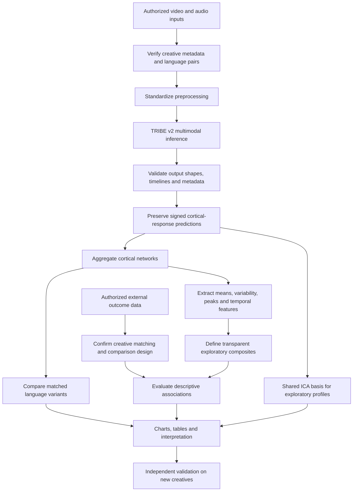

# Brain AI — Multimodal Creative Analysis

An applied ML portfolio project exploring video-and-audio analysis with TRIBE v2, reproducible feature extraction, temporal visualization, and evaluation against external outcomes.

## Project question

Can model-predicted cortical-response features provide useful hypotheses for comparing video creatives and language variants?

The project brings together multimodal inference, data validation, statistical analysis, and communication of uncertainty.

## Workflow

## Analytical approach

- Record input identity and language pairing in a manifest.
- Use a fixed model revision and consistent preprocessing.
- Validate inference artifacts before comparing creatives.
- Compare raw means within the same cortical network.
- Use a shared reference when comparing standardized temporal features.
- Examine average response, variability, peaks, and duration separately.
- Distinguish observed outcomes from model-derived response features.
- Evaluate hypotheses on an independent dataset before making predictive claims.

## Interpreting the outputs

TRIBE v2 estimates average-subject cortical responses from multimodal inputs. These are model predictions, not participant brain scans collected by this project.

Signed values can be negative. They are not probabilities. Network labels do not directly establish psychological states, and analyst-defined attention or engagement composites require independent validation.

Correlations in a small creative sample cannot establish causation or reliable predictive performance. Creative matching, outcome denominators, campaign conditions, and multiple feature comparisons all affect interpretation.

## Skills demonstrated by the workflow

Python · Applied ML · Multimodal inference · Data validation · Statistical analysis · Temporal visualization · Reproducible research · Technical communication

## Results and reproducibility

This public overview documents the methodology. Campaign-derived tables, charts, and the accompanying detailed report are pending confirmation of clearance for public sharing.

Original media, campaign workbooks, model weights, inference caches, and credentials are not part of this public overview. Full inference cannot be reproduced from this overview alone.

## Attribution

The workflow builds on [Meta's TRIBE v2 research model](https://github.com/facebookresearch/tribev2). Upstream code, models, and third-party assets retain their respective licenses and usage conditions.
