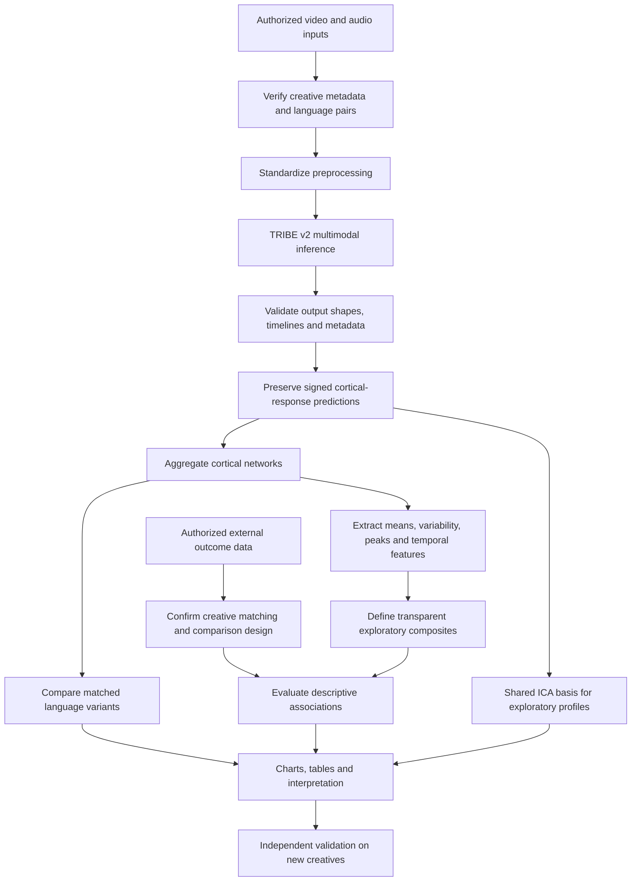

# Brain AI — Multimodal Creative Analysis

An applied ML portfolio project exploring video-and-audio analysis with TRIBE v2, reproducible feature extraction, temporal visualization, and evaluation against external outcomes.

## Project question

Can model-predicted cortical-response features provide useful hypotheses for comparing video creatives and language variants?

The project brings together multimodal inference, data validation, statistical analysis, and communication of uncertainty.

## Workflow

## Analytical approach

- Record input identity and language pairing in a manifest.
- Use a fixed model revision and consistent preprocessing.
- Validate inference artifacts before comparing creatives.
- Compare raw means within the same cortical network.
- Use a shared reference when comparing standardized temporal features.
- Examine average response, variability, peaks, and duration separately.
- Distinguish observed outcomes from model-derived response features.
- Evaluate hypotheses on an independent dataset before making predictive claims.

## Interpreting the outputs

TRIBE v2 estimates average-subject cortical responses from multimodal inputs. These are model predictions, not participant brain scans collected by this project.

Signed values can be negative. They are not probabilities. Network labels do not directly establish psychological states, and analyst-defined attention or engagement composites require independent validation.

Correlations in a small creative sample cannot establish causation or reliable predictive performance. Creative matching, outcome denominators, campaign conditions, and multiple feature comparisons all affect interpretation.

## Skills demonstrated by the workflow

Python · Applied ML · Multimodal inference · Data validation · Statistical analysis · Temporal visualization · Reproducible research · Technical communication

## Directional findings

Across the seven creatives in the exploratory outcome comparison, higher values of the analyst-defined mean engagement composite tended to align with higher observed view-through rates (VTR). Mean Limbic-network and ventral attention network (VAN) responses also showed positive descriptive associations.

The pattern was mixed across features. Spending more time above an attention or engagement threshold did not consistently align with a higher VTR rank. The findings support evaluating selected features in a larger study; they do not establish an overall rule that higher brain response produces better advertising outcomes.

| Model-derived feature | Observed direction in this sample | Interpretation |
|---|---|---|
| Mean engagement composite | Positive association with VTR, including rank ordering | Candidate for independent evaluation |
| Mean Limbic-network response | Positive association with VTR | Exploratory association; not direct emotion measurement |
| Mean VAN response | Positive association with VTR | Candidate feature requiring validation |
| Attention high-time | No consistent positive rank alignment | More time above threshold did not reliably track VTR rank |
| Engagement high-time | No consistent positive rank alignment | Mean level and time above threshold describe different properties |

### What this result establishes

The pilot found directional alignment between selected TRIBE-derived features and observed VTR. It provides a hypothesis for further validation, rather than a validated engagement predictor.

This observational analysis does not estimate incremental lift or a percentage increase in VTR. A correlation coefficient is not a growth percentage, and neither correlation nor rank agreement demonstrates that changing a model feature would improve VTR.

### Limits of the comparison

- The external-outcome comparison contains only seven creative observations.
- Creative-name matching was inferred and requires formal confirmation.
- Outcome averaging was unweighted because impression denominators were unavailable.
- Campaign delivery conditions were not controlled.
- Several features were examined, so chance associations are possible.
- Composite weights and thresholds are analytical choices.
- Predictive performance has not been established on an independent set.

### Public reporting scope

Results are summarized at the level of association direction. Campaign identifiers, creative names, audience labels, individual VTR values, VTR ratios, growth percentages, per-creative rankings, and original campaign charts are omitted. This summary cannot independently reproduce the private numerical comparison.

## Reproducibility scope

The public repository documents the workflow and directional findings. Original media, campaign workbooks, numerical outcome tables, model weights, inference caches, and credentials are excluded. Full inference and the external-outcome analysis cannot be rerun from this overview alone.

## Attribution

The workflow builds on [Meta's TRIBE v2 research model](https://github.com/facebookresearch/tribev2). Upstream code, models, and third-party assets retain their respective licenses and usage conditions.
